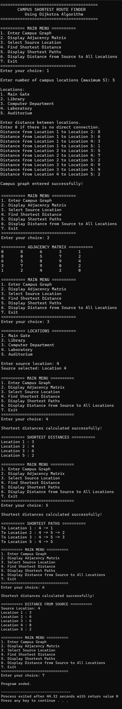

<div align="center">



</div>

<div align="center">

# 🏫 Campus Shortest Route Finder

> A comprehensive **Campus Shortest Route Finder** implemented using **Dijkstra's Algorithm** in C

  

**Weighted Graph | Adjacency Matrix | Dijkstra's Algorithm | Shortest Path**

</div>

---

## Table of Contents

- [About the Project](#-about-the-project)
- [Features](#-features)
- [Tech Stack](#-tech-stack)
- [Data Structures Used](#-data-structures-used)
- [Installation & Usage](#-installation--usage)
- [Project Workflow](#-project-workflow)
- [Learning Outcomes](#-learning-outcomes)

---

## About the Project

The **Campus Shortest Route Finder** is a console-based application that finds the shortest distance between different locations on a college campus.

It demonstrates the practical implementation of **Dijkstra's Algorithm** using a **weighted graph represented by an adjacency matrix**.

The system allows users to enter the campus road network, select a source location, calculate the shortest distances to all other locations, and display the corresponding shortest paths.

---

## Features

| Feature | Description |
| :------------------------ | :----------------------------------------------- |
| **Enter Campus Graph** | Add distances between campus locations |
| **Display Matrix** | View the weighted adjacency matrix |
| **Select Source** | Choose the starting campus location |
| **Shortest Distance** | Find the minimum distance using Dijkstra's Algorithm |
| **Shortest Paths** | Display the shortest route to each location |
| **Distance from Source** | Display distances from the selected source |
| **Menu Driven** | Perform all operations through a simple menu |

---

## Tech Stack

```text
+------------------+------------------+------------------+
|   Programming    |      Graph       |    Algorithm     |
+------------------+------------------+------------------+
|        C         | Weighted Graph   |    Dijkstra's    |
|     Language     | Adjacency Matrix |    Algorithm     |
+------------------+------------------+------------------+

```
---

## Data Structures Used

### Weighted Graph

The campus road network is represented using a **weighted graph** with an adjacency matrix.

Each campus location represents a vertex, and each road represents an edge with a non-negative distance.

### Key Concepts Applied

- ✅ **Adjacency Matrix** — Stores the distances between campus locations
- ✅ **Weighted Graph** — Represents campus locations and roads
- ✅ **Dijkstra's Algorithm** — Finds the shortest distance from the selected source
- ✅ **Parent Array** — Stores the predecessor of each location for path reconstruction
- ✅ **Greedy Method** — Selects the unvisited location with the minimum distance
- ✅ **Arrays** — Store distances, visited status, and parent information

---


## Installation & Usage

### Step 1: Clone or Download the Project

Clone the repository using Git:

```bash
git clone https://github.com/Aakruti2007/campus-shortest-route-finder.git
cd campus-shortest-route-finder
```

### Step 2: Compile the Code

Open the terminal or command prompt inside the project folder and run:

```bash
gcc main.c -o campus_route
```

### Step 3: Run the Program

Run the program using:

```bash
./campus_route

```
---

### Sample Output


 

---


## Project Workflow

```text
┌─────────────────────────────────────────────────────────────┐
│                    MAIN MENU                                │
│  1. Enter Graph   2. Display Matrix   3. Select Source      │
│  4. Shortest Distance   5. Shortest Paths   6. All Distance │
│  7. Exit                                                    │
└─────────────────────────────────────────────────────────────┘
                              │
                              ▼
                  ┌─────────────────────┐
                  │  ENTER CAMPUS GRAPH │
                  └──────────┬──────────┘
                             │
                             ▼
                  ┌─────────────────────┐
                  │ SELECT SOURCE NODE  │
                  └──────────┬──────────┘
                             │
                             ▼
                  ┌─────────────────────┐
                  │ DIJKSTRA'S ALGORITHM│
                  └──────────┬──────────┘
                             │
                             ▼
                  ┌─────────────────────┐
                  │ CALCULATE SHORTEST  │
                  │     DISTANCES       │
                  └──────────┬──────────┘
                             │
                             ▼
                  ┌─────────────────────┐
                  │ DISPLAY SHORTEST    │
                  │ PATHS & DISTANCES   │
                  └─────────────────────┘

```
---

## Learning Outcomes

Through this project, we have gained hands-on experience in:

- Understanding and implementing **Dijkstra's Algorithm**
- Representing real-world networks using **weighted graphs**
- Working with **adjacency matrices**
- Finding shortest paths using a **greedy approach**
- Using **parent arrays** for shortest path reconstruction
- Writing **modular and menu-driven** C programs
- Analyzing the **time complexity** of an algorithm

---

